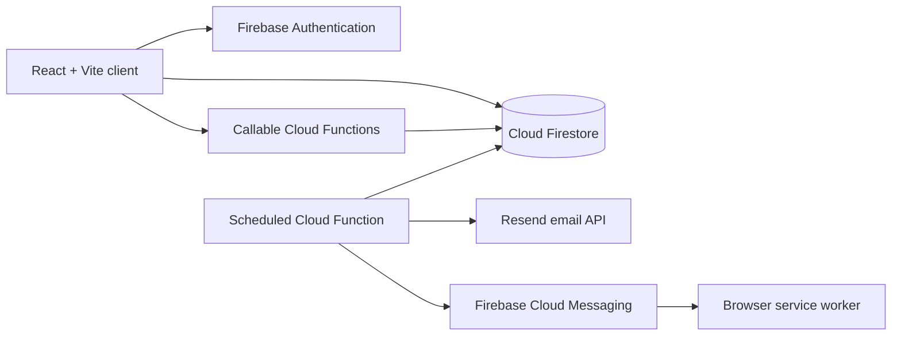

# SaarthiCare architecture

## High-level flow

## Frontend responsibilities

- React Router divides the public welcome/authentication experience from protected app routes.
- `AuthContext` subscribes to Firebase Authentication state.
- `SaarthiCareContext` provides a common state interface. With Firebase credentials and a signed-in user, it subscribes to Firestore; without credentials it uses a clearly labelled fictional local demo.
- UI permissions are convenience checks only. They improve the experience but are never the production security boundary.
- `services/firebaseRepository.ts` converts Firestore documents into typed UI models. `services/firebaseActions.ts` contains client-side Firestore writes and callable function invocations.

## Trust boundaries

1. The browser may read shared records only when Firestore rules prove active membership.
2. The browser may create and update permitted medication, schedule, appointment and care-note records only for a patient profile in which the signed-in user has the required membership permission.
3. The browser cannot directly create or edit membership records, invitations, audit logs or reminder events. Per-member grants are changed through an owner-only callable function.
4. `createInvitation`, `redeemInvitation`, `confirmDose`, `bootstrapPatientProfile` and preference updates run as trusted Cloud Functions.
5. Dose confirmations run in a Firestore transaction. The function checks active membership and dose status before updating the dose and writing the audit entry.
6. Invitation codes are random, hashed before storage, one-time, expiring, optionally email-bound and rate-limited per account.

## Reminder lifecycle

`processCareReminders` runs every five minutes in the `Asia/Kolkata` timezone. It materializes deterministic pending dose records for active schedules for the current and next local day. A deterministic dose document ID avoids creating the same scheduled dose twice. It then:

- finds upcoming doses within the next 15 minutes;
- marks pending doses missed after a 5-minute grace period;
- finds scheduled appointments in the next 24 hours;
- checks each active member's notification preferences;
- creates a deterministic reminder event per reminder and recipient;
- sends email through Resend when the secret and sender are configured, otherwise stores `dev_outbox`;
- sends a browser push when the member has opted in and has a registered FCM token.

The idempotency key is based on the event type, source record ID and recipient UID. If an event exists, the scheduler does not create a duplicate.

## Google services in use

- **Firebase Authentication:** user email/password identity and password reset.
- **Cloud Firestore:** primary database and security rules.
- **Firebase Cloud Functions v2:** trusted operations and scheduled reminder processing.
- **Firebase Cloud Messaging:** browser push notification transport where configured.
- **Firebase Hosting:** static frontend deployment and SPA route rewrite.

Resend is an external transactional email provider. Vitest, Playwright and Firebase Emulator Suite support validation.
